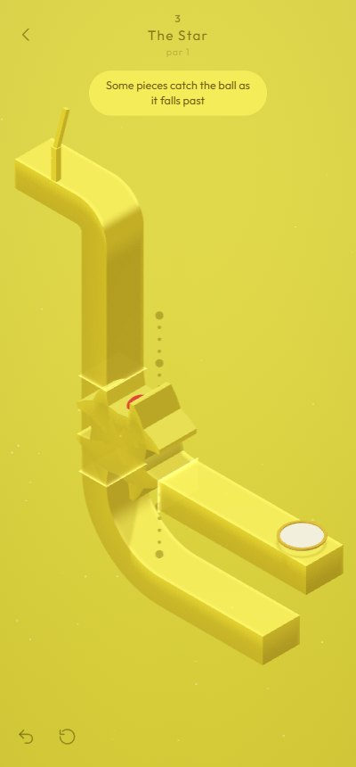
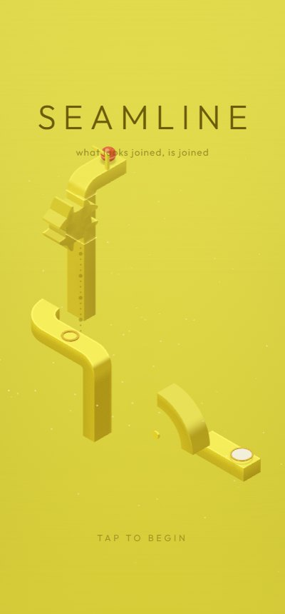
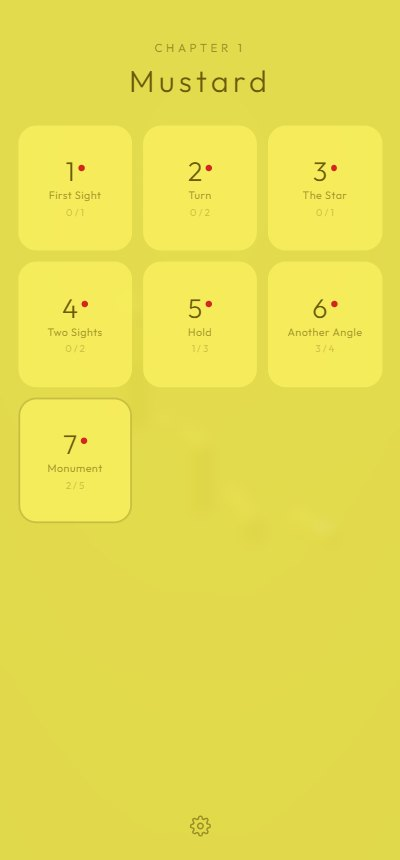
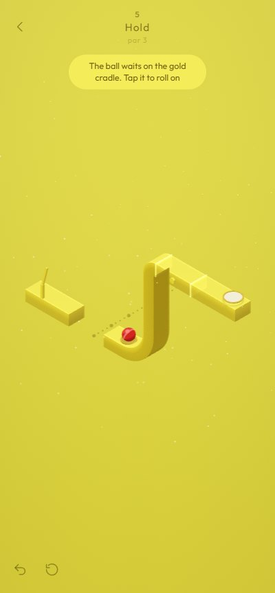
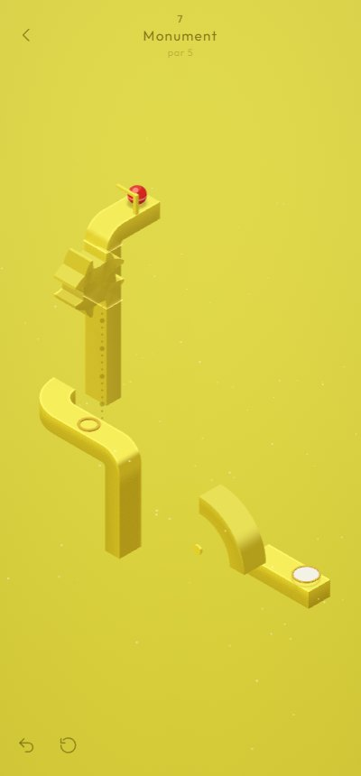
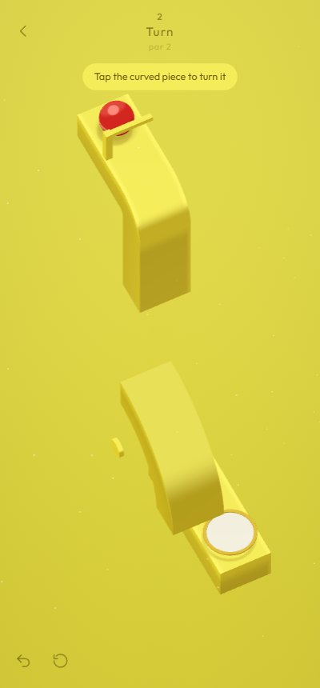
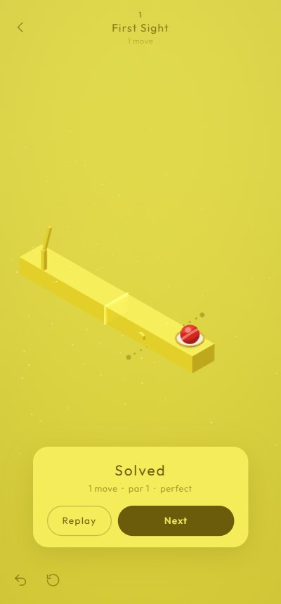

<div align="center">

# Seamline

**What looks joined, is joined.**

A calm perspective puzzle for your phone. A red ball rolls along floating track, and the pieces don't
actually touch. But if two ends meet *on screen*, the ball rolls straight across. Slide beams, turn
elbows, line up the Star and turn the world until an impossible path exists, then let the ball go.

**Android: download the apk from [Releases](https://github.com/Sayandeep1013/Seamline/releases).**



</div>

---

## Screenshots

| Title | Chapter 1 | Hold |
|---|---|---|
|  |  |  |

| Monument | Peek | Solved |
|---|---|---|
|  |  |  |

## How it plays

- **The camera is a true isometric projection.** Two track ends join when they line up on screen,
  run the same way and have the ball on the same side. It's exact grid maths, not pixel hunting:
  if it looks connected, it is.
- **You set up the path and the ball does the rest.** Tap the ball to release it. It rolls on its own
  and obeys real physics wherever there's no join. It falls off open edges and lands on whatever is really
  below. If nothing is, it drifts back to the start. It bumps softly at capped ends. There are no timers,
  no lives and no fail screens.
- **Everything is solid.** Pieces stop against track, other pieces and the ball instead of passing through.
- **Your moves:**
  - **slide** beams and the Star along their dotted rails;
  - **tap** an elbow to turn it a quarter;
  - **swipe** across empty space to turn the whole world (in levels that allow it);
  - **tap** the ball when it waits on a cradle;
  - **hold two fingers** to peek: the camera tilts to show the true 3D depth, then settles back (Space on desktop).
- **Seven levels in Chapter 1, "Mustard"**, each teaching one idea:

  | | Level | Idea |
  |---|---|---|
  | 1 | First Sight | a beam that isn't touching, but is |
  | 2 | Turn | rotate an elbow |
  | 3 | The Star | catch the ball mid-fall |
  | 4 | Two Sights | chain two joins, and ignore the one that lights up for nothing |
  | 5 | Hold | one beam, two jobs |
  | 6 | Another Angle | the camera is a piece |
  | 7 | Monument | everything at once |

- **Depth you can read.** Soft warm shadows, solid shading, and a gentle depth haze. Joined pieces
  share a tone, so the seams stay invisible.
- **Soothing by design.** Synthesised pentatonic chimes, a generative ambient pad, soft haptics,
  drifting dust and slow-motion for your first impossible crossing. Every snap glides into place without bouncing.
- **Stuck?** After a short while a hint button appears. It shows the next move of a shortest solution,
  worked out by the same solver that checks every level.

## Download (Android)

1. Get `seamline-<version>.apk` from the latest [Release](https://github.com/Sayandeep1013/Seamline/releases) on your phone.
2. Open it. Android asks once to allow installs from your browser or file manager; allow it, then install.
3. Play in portrait. Drag beams, tap elbows, swipe to turn, tap the ball.

Android 7.0 or newer. The app asks for no permissions and never goes online. Progress and settings stay on the phone.
The APK is built by GitHub Actions from this repository. Nothing native is built locally.

## Building from source

Node 22.

```bash
npm install
npm run dev          # play in the browser at http://localhost:5173 (also on your LAN, so you can open it on your phone)
npm test             # rule truth tables + every level solved at its par
npm run solve        # print each level's shortest solution
npm run build        # production web build in dist/
```

Android builds run in the cloud: every push to `main` builds an APK artifact, and pushing a tag like `v0.2.0` publishes
a Release with the APK attached (see [`.github/workflows/android.yml`](.github/workflows/android.yml)).
To refresh the native project after changing web code or plugins: `npm run android:sync`.
To regenerate the launcher icons and splash screens: `npm run icons`.

## How it's built

TypeScript, Three.js and Capacitor. There's no game engine and no physics engine: the ball follows the track graph
deterministically, which is what lets a solver prove every level fair.

```
src/core/      the rules, pure TypeScript: integer grid, track segments, the join rule, ball follower + falls,
               solidity (collision sweeps), BFS solver
src/render/    orthographic iso camera, three-tone face shader, swept track geometry, seam glow, dust motes
src/anim/      frame-rate-independent damping, tweens and critically damped springs
src/audio/     Web Audio synthesis: FM chimes, thocks, generative common-tone pad, generated reverb
src/app/       level controller (input, ball, feedback), Capacitor bridges (haptics, storage, back button)
src/ui/        title, level select, HUD, settings sheet, result card
levels/        one JSON file per level; tests/levels.test.ts proves each solvable at its par
android/       the Capacitor Android shell (portrait-locked), built only in CI
tools/         icon and splash renderer
```

The design lives in [`GAME_PLAN.md`](GAME_PLAN.md), with the decision log in §16. The feel, motion and audio research
is in [`research/FEEL_AND_ATMOSPHERE.md`](research/FEEL_AND_ATMOSPHERE.md).

## Status

| | |
|---|---|
| v0.2.0 | Real falls, solid pieces, depth-correct crossings, shadows + depth tint, peek gesture; L7 re-laid for portrait; steady 60 fps on a mid-range phone |
| v0.1.0 | Chapter 1 (7 levels), slide / rotate / turn-the-world / rest pads, the Star, hints, settings, saved progress, Android APK |
| Next | Penrose loop and perspective-landing levels, Chapter 2 palette, a signed Play Store build |

## Credits

- Everything (geometry, shaders, sound, music, icons) is generated in code in this repository.
- Font: [Outfit](https://fonts.google.com/specimen/Outfit) by Rodrigo Fuenzalida (SIL Open Font License 1.1), bundled for offline play.
- Rendering: [three.js](https://threejs.org) (MIT). App shell: [Capacitor](https://capacitorjs.com) (MIT).
- Inspired by a YouTube Short by @WorldGamexMe, and by *Monument Valley*, *echochrome* and *Viewfinder*.
